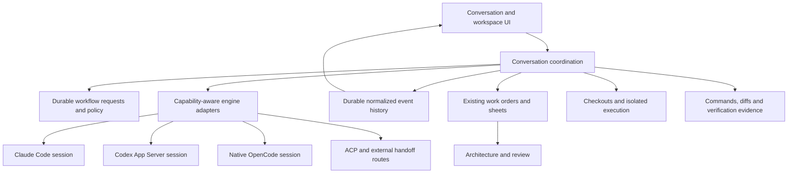

# Ambio as the daily coding workspace

Proposal and code audit, 2026-10-29. Baseline: `d78d722` on `main`.
Open implementation work belongs in [WORK.md](../WORK.md); this document
explains the sequence, boundaries and acceptance criteria. No application
behavior or recorded decision is changed by this proposal.

Implementation update, 2026-11-04: new Codex conversations now use native App
Server, with a pinned explicit exec compatibility route. Streaming, corrections,
approvals, Stop/resume, native review and usage are implemented in the existing
delivery contract. See [implementation and qualification](testing/CODEX_APP_SERVER.md).
The remaining milestones below retain their original broader scope.

## Outcome

Max should be able to open Ambio, discuss a problem, let Claude Code or Codex
investigate and build, steer the work, test it, review the code and architecture,
and finish the Git workflow without needing their separate interfaces.
Native Ambio chat should offer a deliberate, tested set of capabilities on the
same workspace surface. Using a model through OpenCode does not imply the
capabilities of that model vendor's coding agent.

Max has **not yet used Ambio directly for coding**. This is a readiness roadmap,
not a diagnosis of observed dissatisfaction. His first specific preference:
keep the ability to ask, plan and build, but make it less boxy; let the agent
ask to change modes and request other useful actions within the conversation.

The first success criterion is one excellent real coding session. The longer
term criterion is several normal development days completed inside Ambio,
with every forced departure recorded and prioritized.

## What exists, and what is missing

These are implementation observations, not claims that every provider or
packaged platform has passed a live account trial.

| Area | Present today | Gap to close |
| --- | --- | --- |
| Common conversation surface | Shared list, names, unread state, notifications, Markdown, map/file links, mode and model controls | The surrounding UI is shared; the execution and history models still differ |
| Native Ambio chat | Bundled OpenCode, API services and ChatGPT connection, saved sessions, streamed text, tools, questions, edit approvals, Stop and restart handling | Native capabilities differ from vendor agents; delegation is disabled; no registered extra MCP services in its generated config |
| Claude Code and Codex | Started in the project, workspace-bound Ambio MCP, host-session resume, activity, Stop, addressed claim/reply | Primarily one subprocess turn at a time; no integrated live steering; rich tool results are reduced to short activity text |
| Agents in another app | MCP installation, presence/verification, addressed work, handoff and opt-in watching | Installation is not conversation control. Some questions, execution and stopping still require that app |
| Intent and permissions | Ask / Propose / Build contracts, native approval cards, permission desk | Intent is coupled to access. Most managed CLI Builds use broad access; enforcement differs by host and platform |
| Active conversation | Running status, progress and Stop | Composer is disabled while working; no send-now versus next-turn queue distinction |
| Attachments | Selected systems/files/infra/planned nodes and sheets | No general image, document or arbitrary-file message payload in the shared send types |
| Continuity | Native saved history and host resume; daemon sends earlier work-order turns | Fallback context is the last 20 turns with each request/reply clipped to 6,000 characters; no durable task-memory strategy |
| Parallel work | Managed CLI worktrees, checkout overlays/collisions, apply/discard | Native chat has no equivalent first-turn worktree option; no common task tree, dependency scheduling or child-agent supervision |
| Architecture loop | Draw-first, approval, frozen work-order scope, comparison, attribution, Review Changes, investigations | Seamless movement between conversation, sheet, code diff and test evidence; independent verification beyond structure |
| Git | Branches/worktrees and native fetch, fast-forward pull, push and publish | Commit/staging, merge/conflict workflow, PR review and agent-accessible Git operations remain work |
| Daily development surfaces | Source preview, documents, map, agent logs and investigation tools | A cohesive diff/review surface, runnable task/terminal controls and browser/preview workflow are not supplied by the current chat path |

Code anchors: [conversation UI](../src/renderer/components/SendToAgentDialog.tsx),
[native UI](../src/renderer/components/AgentChatPanel.tsx),
[native runtime](../electron/agentChat.ts),
[CLI drivers](../electron/agentDrivers.ts),
[runner](../electron/agentDelivery.ts),
[chat types](../src/shared/agentChat.ts),
[driver events](../src/shared/agentDelivery.ts),
[fallback history](../archd-go/internal/db/inbox.go),
[permission desk](../archd-go/internal/api/agent_permission.go).

Specific constraints matter:

- Native Build uses approval-based modifying tools, denies `task` delegation
  and external directories, disables general/explore agents and default plugins,
  and isolates OpenCode configuration. Expand it through explicit capabilities;
  do not remove that isolation as a shortcut.
- Native Ask/Propose allow selected reads and planning operations but deny
  other tools by default. CLI Ask/Propose can run commands, with differing edit
  restrictions. The same label currently does not promise identical behavior.
- The CLI event model has only text/tool/error/thinking text. Driver summaries
  clip messages, commands and paths, and the runner keeps up to 400 activity
  events. Full raw logs are separate; the activity feed is not a structured
  execution record. Claude child-agent messages are explicitly filtered out.
- Permission requests in archd are in memory and normally wait 110 seconds,
  up to ten minutes. They are not durable decisions surviving daemon restart.
- Both execution routes prevent overlapping managed writers in the same root.
  Preserve this protection while adding explicit isolated concurrency.

## Conversation design: capability without three boxes

Recommended experience: one conversation in which the agent explains the next
step and can offer a concrete action. Keep explicit Ask / Propose / Build
controls as overrides and visible status, rather than requiring the person to
predict the right mode before every message. The exact default needs a recorded
decision; do not silently alter the existing turn contract.

Example interaction:

> You: Could we make sign-in work offline?
>
> Agent: I'll inspect how sign-in and local storage work.
>
> Agent: This crosses Authentication and Local Storage. I can draw the change
> on a sheet before editing code. **Draw plan** · **Keep discussing**
>
> Agent: The plan is ready. **Open plan**
>
> After you approve the relevant proposals: Agent: I can implement the approved
> plan in a separate worktree. **Build approved plan** · **Keep discussing**
>
> Agent: The check needs a local test database. **Review setup command**
>
> Agent: Tests passed. **Review changes**

An action card names the purpose, scope and consequence. The agent can request
a mode change, a clarification, a check, a worktree, a model change, delegation
or an external action. Each action still uses its own authorization rules.
Support ordinary text answers as well as buttons, with clear acknowledgement.
Do not invent a generic approval that grants every consequence of a request.

Separate four concepts:

| Concept | Example | What it authorizes |
| --- | --- | --- |
| Conversation intent | Discuss, draw a plan, implement | The kind of work requested |
| Execution policy | Ask me, project access, full access | Which tools/paths/network operations may execute |
| Architecture decision | Approve these proposals at this sheet revision | The proposed structural scope |
| External action decision | Push this branch; create this PR | That particular action under existing Git/service rules |

Changing to Build must not approve an unreviewed sheet, bypass permissions,
switch accounts, or expand the checkout. A nonstructural fix need not acquire
a sheet merely because it is a Build. An already authorized build must not
generate repetitive confirmation cards for every routine step.

Implementation requirements for requests:

- Store requests and answers durably, linked to project, conversation, run,
  turn and applicable scope/revision. Distinguish pending, answered, expired,
  cancelled and superseded requests. Double-clicks and lost acknowledgements
  must not execute twice.
- The human can initiate the same transitions the agent can request. An agent
  cannot accept its own request or treat silence as consent.
- Apply a transition at a supported safe boundary. If a host cannot change
  configuration during a turn, acknowledge and continue in a subsequent turn
  without pretending the current process changed policy.
- A plan revision, cancellation, account/root change or completed turn can
  invalidate a request. Restart restores the decision history; it does not
  automatically re-execute an answered action.
- Keep product workflow requests distinct from vendor tool approvals and
  native question forms. Normalize their presentation without losing meaning.
- Extend an existing MCP operation where appropriate under
  [MCP_SURFACE.md](MCP_SURFACE.md); do not add one tool per button. Preserve
  scoped mapping credentials and finite setup-mapping behavior.

## Proposed architecture

Use the existing Agent Connections, Agent Chat UI, Work coordination, Sheets
and Work Orders, Project Lifecycle and MCP Agent Interface boundaries. Avoid
creating a separate product stack for each agent.

This is a proposed responsibility diagram, not a claim that these boxes are
new live systems or approved changes. The initial Ambio map read returned
matching project systems and source paths; subsequent calls reported Ambio
unavailable. No sheet, planned elements or approvals were saved. Before any
structural implementation, verify the connected project, reuse current systems
and draw only that slice's new boundaries/dependencies on a reviewable sheet.

Recommended responsibility changes, introduced incrementally:

- **Work coordination** owns common conversation/run identity, lifecycle,
  request decisions and durable event envelopes. Today these are distributed
  across daemon work orders, Electron native conversation JSON, runner receipts
  and renderer preferences. Add a common facade and migrate incrementally;
  do not start by rewriting both runtimes or duplicating entire transcripts.
- **Agent Connections** retains provider authentication, process ownership,
  protocol adapters and discovery. Adapters declare versioned capabilities:
  resume, steer, queue, permissions, images, tools, subagents, usage and review.
  Unsupported features get explicit fallback behavior, never silent escalation.
- **Agent Chat UI** consumes normalized events and renders typed cards for
  workflow requests, questions, tools, commands, edits, artifacts and checks.
  Preserve original provider payload references for diagnosis and replay.
- **Project Lifecycle** owns checkout/execution targets shared by all engines.
  **Sheets and Work Orders** remains authoritative for approved scope and
  structural review. Integration must not make a model's completion equivalent
  to acceptance, matching architecture or passing tests.
- Verification records bind commands, checkout, source revision/diff fingerprint,
  timestamps, exit status and outputs. Later edits invalidate applicable results.
  Distinguish trusted execution evidence from an agent's reported checks.

Every new user-facing artifact needs both human controls and an agent read/write
path, attribution and applicable journal/history behavior.

## Roadmap and release gates

Milestones are ordered by dependency and user value, not estimated calendar
dates. Reliability is part of each milestone. First deliver narrow vertical
slices for Claude Code and Codex, then prove the same contracts in native chat
and other supported routes.

| Milestone | Deliverable | Exit gate |
| --- | --- | --- |
| 0. First real session | Record installation/auth, an explanation, small edit, checks, restart/follow-up and review using each priority engine | Max completes the journey; every departure or confusing step is logged with reproduction and provider/version |
| 1. Natural conversation | Durable workflow requests, agent-requested mode changes, readable access policy, common run identity and typed events | Discuss → request plan → review → authorized build works without manually resending scope; stale/duplicate approvals cannot start work |
| 2. Full coding engines | Rich Codex and Claude sessions, streaming tool results, queue/steer/interrupt where supported, attachments, context continuity | A meaningful bug fix and a cross-system feature pass coding checks and architecture review in each engine without its external UI |
| 3. Complete development loop | Inline code diffs, command/task output, dev server/preview/browser workflow, reproducible verification and native Git completion | Reproduce a UI bug → inspect/browser test → fix → test → review → commit → PR, all in Ambio |
| 4. Native chat capability parity | Explicit native tool/extension profiles, tested task support, isolated worktrees and supported delegation | The agreed coding task suite passes with native chat; unavailable engine-specific capabilities are visible |
| 5. Parallel and long-running work | Child tasks, isolated agents, handoff context, collision management and durable recovery | Two tasks run in isolated checkouts, survive interruptions, and combine only after review without losing code or decisions |
| 6. Daily-driver quality | Packaged cross-platform qualification, provider compatibility, performance/accessibility and sustained dogfooding | Five normal development days without a forced move to another coding-agent UI; no lost/duplicated work in the failure suite |

### Milestone 0: establish evidence before assuming parity

Use a disposable project first, then Ambio itself. Run the same tasks through
Claude Code, Codex and native chat; test an external watching route separately.
Record task success, missing capabilities, time to first useful output, context
recall, questions, checks, cost/usage when reported and any manual recovery.
Compare equal tasks and account/model settings, not raw token counts across
different engines. Separate engine limitations from Ambio adapter limitations.

Reuse `agent-discovery-packaged-validation`, `work-order-delivery-live`,
`integrated-chat-provider-live`, `chatgpt-native-live-validation` and
`propose-recorded-runs`. Historical recorded smoke tests are evidence, not proof
for a newly installed vendor version. Reproduce old Inbox bugs before fixing
them: the saved-chat deletion test already passes in this audit.

### Milestones 1–2: make the agent fully present

1. Implement workflow requests first as a thin vertical slice through existing
   conversations, without waiting for a whole storage rewrite. Preserve current
   manual mode controls; use the example above as the acceptance journey.
2. Add an event contract with stable identities, ordering, replay/deduplication,
   parent-child relationships, status and artifact/output references. Render
   summaries progressively; retain detailed output for inspection. Do not store
   only the clipped display strings. Paginate/virtualize long history.
3. Add a Codex App Server adapter. Official documentation exposes active-turn
   steering, structured item/command/file events, approvals, thread continuation,
   review and usage signals. Probe installed-version support and retain the
   existing exec path as an explicit fallback. This is a richer connection to
   Codex, independent of native ChatGPT/OpenCode chat.
   [Official Codex App Server documentation](https://learn.chatgpt.com/docs/app-server).
4. Add a persistent interactive Claude integration. Its documented streaming
   input supports queued messages, interruptions, images and tool interaction.
   Evaluate the CLI streaming protocol versus Agent SDK for the supported account
   path before choosing; do not assume an SDK migration preserves subscriptions.
   [Claude streaming input](https://code.claude.com/docs/en/agent-sdk/streaming-vs-single-mode).
   The SDK overview explicitly restricts third-party use of claude.ai login/rate
   limits absent approval, so account support is a release gate, not an inferred
   capability. [Claude SDK overview](https://code.claude.com/docs/en/agent-sdk/overview).
5. There is a smaller interim Claude improvement: partial-message streaming and
   parent-linked child-agent events are documented, while the current adapter
   reads completed blocks and excludes child messages.
   [Claude programmatic use](https://code.claude.com/docs/en/headless).
6. Keep the composer usable while working. Offer Send to running agent, Queue
   next message and Stop, according to declared host support. Acknowledge when
   input was delivered and whether it belongs to the current or next turn.
   Do not silently turn a steering message into a second build.
7. Add file/image payloads end to end, clipboard/drop, previews, source-range
   attachments, checkout-correct path resolution and engine capability checks.
   Existing canvas/sheet references remain first-class attachments.
8. Add inspectable context: attached scope, project instructions, skills,
   previous decisions, current task summary and compaction boundaries. Retrieve
   older relevant turns instead of relying on the clipped fallback alone.
   Keep agent/provider pinned; offer a new linked handoff conversation rather
   than silently switching an existing conversation's engine or account.

Reuse `agent-permission-modes`, `work-order-recovery`, `mcp-tool-steering` and
`agents-draw-first`. Permission controls must say what the host actually enforces,
including Windows behavior. Preserve the temporary full-access default until
the recorded decision is deliberately updated.

### Milestone 3: close every practical escape hatch

- **Code review:** changed files grouped by system, inline/hunk diffs, comments
  that become scoped revision requests, staged versus unstaged state, safe
  discard/checkpoints that preserve unrelated user edits, source navigation and
  a small editable source surface. Do not require a full IDE rewrite first.
- **Commands and environments:** commands with cwd, output, exit status and
  Stop; reusable run/test tasks; dev servers with ports and lifecycle; terminal
  fallback for genuinely interactive auth/setup. Carry checkout context into
  every action. Make missing dependencies and environment values actionable.
- **Browser and visual work:** preview the relevant running app, attach a
  screenshot, inspect browser console/network failures and run a reproducible
  browser test through an available engine tool or managed browser service.
  Agent-controlled browser actions and human navigation share visible state.
- **Architecture in the conversation:** selection → question, proposed sheet →
  review, approved plan → work, changed system → diff and evidence. Human
  decisions reach the right active agent at a safe boundary; no duplicate
  sheets, no forgotten rejected additions, no forced camera jumps every event.
- **Completion evidence:** separate code complete, checks passed, architecture
  matched and human accepted. Run sheet-attached checks independently when
  configured; show failures, skips and stale results, not a single success badge.
- **Git and PRs:** finish existing `git-commit`, `git-merge-with-map`,
  `git-pull-requests` and `git-sync-mcp`. Include PR comments, CI failure inspection and
  revision loops. Preserve [Git decisions](GIT_WORKFLOW.md), confirmation rules,
  authored changes and worktree apply behavior. Do not resolve open merge-policy
  questions by implementation accident.

### Milestone 4: native chat becomes a deliberate coding product

Inventory each native OpenCode tool against the same tasks used for vendor
engines: search, edits/patches, shell, tests, web access, images, debugging,
background processes, tool discovery and context management. Exposing a tool
name is not sufficient; exercise a complete loop and observe the result.

Provide inspectable extension profiles for MCP servers, skills, instructions and
hooks where supported. Show what loaded and what failed. Keep host-native
extensions intact where compatible: Claude's current `--strict-mcp-config`
explicitly restricts MCP to Ambio, so externally configured tools are not
automatically equivalent to an interactive session. Test browser/Figma/GitHub
and other integrations the user actually needs instead of promising every
desktop plugin works in a CLI or another engine.

Give native chat the common isolated execution target and supervised child-task
support before enabling delegation. Show provider/account, model controls,
context limits and usage accurately; do not treat the current provider-wide
1M-token context default as verified for every offered model. Handle renewal,
quota, revocation and compatible/local endpoints with clear recovery. Credentials
remain in the existing main-process/proxy boundary.

### Milestones 5–6: long work stays understandable and recoverable

- Distinguish agent-created child tasks from user-owned conversations. Show each
  child's scope, checkout, tools, progress, dependencies, outputs and cost where
  available. Human and parent can inspect, stop and send a follow-up. Delegation
  stays within authorized scope; creating a child is not blanket permission.
- Preserve one managed writer per checkout by default. Allow isolated concurrent
  worktrees, read-only parallel work and explicit scheduling; show overlapping
  systems before combining changes. Clean up worktrees only through the existing
  reviewed lifecycle, preserving recoverable work.
- On process/app/daemon crash, sleep/wake, disconnect or provider failure,
  reconcile persisted state before presenting Continue. Distinguish resuming,
  retrying inference and starting fresh. Never automatically replay an uncertain
  edit, request, push or submission. No orphan process may silently keep writing.
- Support long-lived tasks, background checks and notifications without needing
  the chat panel open. Add schedules/remote execution only when local lifecycle
  and credentials are robust. Cross-project/multi-root work follows the existing
  `mcp-multi-root`, `git-add-folder` and `multi-window` decision process.
- Qualify packaged Windows, macOS and Linux: sparse PATH, clean/expired accounts,
  keychain failures, proxy/VPN, missing runtimes, vendor updates, non-ASCII paths,
  large outputs, long conversations, keyboard navigation and screen readers.
  Keep the map interactive during streaming and process checks.

## Verification and definition of ready

Maintain a provider/version/platform capability matrix with four evidence
levels: implemented, automated fixture passed, authenticated live run passed,
packaged user journey passed. Missing evidence must not be displayed as failure
or as confirmed support. Engine-specific extras can remain extras.

The same core journeys should cover both human controls and agent requests:

1. Discuss → agent requests planning → draw → human approves → build → checks →
   architecture comparison → review → revision → accept.
2. Send a correction while working, queue another message, answer a question,
   deny an action, stop and continue without duplicated effects.
3. Attach an image and source range; fix a real UI defect and prove it in a
   browser; inspect the resulting diff and failing/passing check.
4. Run a long session through compaction/restart and retrieve an old decision;
   a linked handoff retains required context without pretending to retain hidden
   engine memory.
5. Run isolated concurrent work, detect a collision, review/apply it, commit and
   follow a PR/CI revision loop.
6. Inject lost send acknowledgements, stale plan approvals, duplicate decisions,
   daemon/provider/process failures and account changes; verify no replay, lost
   work, cross-project action or false completion.

Proposed initial service targets, to calibrate on the real machine: display a
send acknowledgement promptly (target under one second excluding inference),
surface activity within one second of receiving the engine event, acknowledge
Stop immediately and confirm termination or explain a bounded failure. Keep
model latency separate from Ambio latency. Require zero lost messages,
unintended duplicate executions and false verified-completion claims in the
failure suite. Five dogfooding days is an initial exit gate, not a promise of
perfection or a substitute for the automated matrix.

Audit checks on 2026-10-29:

- Focused driver, delivery, ACP, connection-model and conversation-preference
  tests: **38 passed**.
- `npm run test:chat`: **4 passed**, using the real bundled OpenCode runtime
  against controlled services, including native ChatGPT-route fixtures, history,
  tools, approvals, cancellation, restart, deletion and finite mapping shutdown.
- Reviewed existing authenticated Windows ChatGPT evidence in
  [CHATGPT_WINDOWS_SMOKE.md](testing/CHATGPT_WINDOWS_SMOKE.md). No new paid
  provider run, packaged-app journey or browser interaction was performed.
- This is documentation-only work. No full build/type/Go/MCP suite was needed
  to verify changed executable behavior, because none was changed.

## Recommended first implementation slice

After the first baseline session, build **agent-requested workflow transitions**
with the current engines: a durable request, an inline action, and an explicitly
authorized next turn carrying the correct plan and scope. Keep the existing
picker as a manual override. Then add typed events and richer Codex/Claude
sessions so steering, approvals and tool details use the same durable contract.

Decide the conversation's initial intent and the treatment of explicit natural-
language build requests before changing defaults. Also confirm whether the first
replacement gate requires both Claude Code and Codex (recommended), and which
browser/extensions are mandatory after the baseline. These are product choices;
they do not block collecting evidence or preparing a reviewable first slice.
