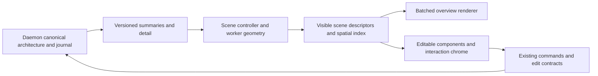

# Ambio canvas scalability plan

Date: 2026-10-20
Status: proposed execution plan; this change contains documentation only.
Starting point: `23963eb` on `codex/canvas-frame-budget`.

Max requested a plan after reviewing the five-part performance audit. The goal
is a reliably smooth Kohler experience with demonstrated headroom for much
larger production and multi-root codebases. No kernel-scale capacity claim has
yet been validated. The Ambio connector returned no matching workspace for this
checkout, so no proposal sheet was created; this is the local reviewable plan.
When the matching workspace is available, reuse an existing scalability sheet
or record these proposed boundaries before structural implementation.

## Goal and acceptance targets

Interactive work should be bounded by the visible scene, its prefetch buffer
and active edits. Total project size may increase indexing/loading time; it
must not force a proportionate increase in camera-frame work or mounted editors.
The Floor remains the complete live architecture even when presentation/data
is materialized progressively. Unknown or loading content must be explicit.

Proposed targets, evaluated on a recorded reference laptop and production build:

| Area | Target / evidence |
| --- | --- |
| Camera, drag, reveal and navigation | At 60 Hz, p95 frame interval <= 16.7 ms plus measured scheduling tolerance; p99 <= 33.3 ms. Report worst intervals and every application-attributable stall > 50 ms. At 120 Hz, also evaluate the 8.3 ms budget; do not infer support from 60 Hz results. |
| Input | p95 time from input dispatch to visible feedback <= 50 ms, including during scene preparation/indexing. The existing 850 ms fit animation is intentional travel time, not input latency. |
| Cold opening | Window/loading feedback within 100 ms of the renderer receiving the open request. Provisional target: useful overview of an already-indexed Kohler map within 1 s warm / 2 s cold. Record time from application launch separately. Calibrate larger-project readiness targets in phase 1; UI remains responsive throughout. |
| Scene size | Same viewport/density with 10x more total entities must not create 10x more mounted components, geometry work on the UI thread, or per-frame allocations. Record counts and timings rather than relying on asymptotic claims. |
| Memory | Repeated navigation reaches a plateau after bounded caches warm; provisional steady-state growth <= 10% over 50 identical cycles. Include main, renderer and worker memory plus peak transfer/allocation costs. Set absolute machine budgets from phase-1 measurements. |
| Correctness | No blank-scene false passes, missing selected targets, lost relationships, dropped durable updates, layout drift, stale worker results or differences between human and agent edits. |

These are engineering acceptance targets, not promises for every device and
unbounded visual density. Pin hardware, display refresh, build, dataset, zoom
path and background workload. Run multiple repetitions; keep slow results.
Separate native timing runs from CPU-instrumented investigation runs. Structural
limits run in ordinary CI; timing gates require a controlled performance runner.

## What the current evidence says

- Kohler repeats vary around 17-42 ms p95; the current canvas is not consistently
  within a 60 Hz budget.
- The 672-node review still has roughly 12,000 document elements and 42-50 ms
  p95, despite the reduction from ~26,000 elements / ~133 ms.
- Initial scene preparation records renderer long frames around 300-650 ms.
  The current worker handles spatial indexing/querying, not all layout.
- Current tests replay snapshots through mocked endpoints. Full daemon loading,
  indexing, clustering and database costs require separate real-data runs.
- An unchanged five-second sheet poll previously triggered repacking; that is
  fixed. Future background features need the same identity/invalidation checks.
- Viewport culling currently retains relationship endpoint shells for handle
  geometry. Dense connected graphs can therefore defeat the intended DOM bound.
  The renderer experiment must remove that dependency without losing edges.

Evidence: [frame-budget audit](testing/CANVAS_FRAME_BUDGET.md) and
[earlier audits](testing/CANVAS_PERFORMANCE.md).

## Phase 1 - Reproducible scale suite and stage tracing

WORK item: `canvas-scale-baselines`. This is the first implementation slice.

Extend `tests/e2e/canvas-performance.spec.ts` and the existing local metrics;
keep the existing interaction/visual suite. Add a shared deterministic fixture
builder rather than multiplying independent ad hoc performance scripts.

Test dimensions independently:

- Real Kohler Floor, actual sheet and generated review; dense 672-node control.
- 1k, 10k and 100k total entities with a fixed visible neighborhood. These are
  scene entities, not claims about repository file capacity. Start a 1m-entity
  metadata stress test only after the smaller levels can load progressively.
- Vary visible density separately (100, 500, 2k, 10k cheap marks), relationship
  density, high-degree hubs, long off-screen edges, depth (including 20+ levels),
  large symbols, sheet opinions, and simulated multi-root identities.
- Cold opening, fast pan/zoom reversals, search and reply-pill flights,
  interruption, drag/resize, background indexing bursts, worker failure,
  close/reopen, and a 50-cycle navigation/memory soak.

Trace snapshot query/serialization/transfer/parse/store application, geometry
packing, scene projection, spatial queries, React commits and browser paint.
Measure input feedback separately from rAF intervals; the camera can report
frames while a click still waits in a queue. Capture peak DOM, active editors,
edge counts, bytes transferred, long tasks and all process/worker memory.

**Done when:** repeated baseline artifacts identify the dominant stages for
Kohler and each completed scale tier; every timed scenario also proves visible
content and interaction correctness. Larger levels that cannot finish are
reported as failures with their limiting stage. The device/tolerance and
absolute memory budget are recorded before using them as release gates.

## Phase 2 - Background, incremental scene preparation

WORK item: `canvas-cold-layout-worker`. Depends on phase 1 tracing.

Extract deterministic numeric layout/packing from `AmbioCanvas.tsx`, initially
`runAlternateAxisLayout` and `buildFloorFrameLayout`. Proposed files under
`src/renderer/canvas/scene/`: `sceneGeometry.ts`, `sceneProtocol.ts`, and
`sceneController.ts`. Evolve the existing `renderBudget.worker.ts` to own prepared
geometry and its spatial index together rather than maintaining duplicate full
models in multiple workers. Final file boundaries are checked at extraction.

Worker input is serializable model/layout data, not React nodes or callbacks.
Output is numeric geometry/visible descriptors; the UI attaches interactions
only to the materialized scene. Remove repeated parent scans where measured;
cache subtrees and invalidate the changed boundary and affected ancestors.
Selection, camera motion and transition flags must not repack the project.

Version results by workspace/root, model revision, sheet revision and request.
Use latest-request wins and cancellation/coalescing; long computations yield
at cancellable chunks so an obsolete job cannot occupy the worker indefinitely.
Do not auto-save generated geometry from a stale result. Retain the last coherent
scene during recomputation, show progress, and revalidate pending edits against
the current revision. A worker crash must leave a recoverable, responsive scene;
never synchronously run a huge replacement job as the fallback.

Profile clone/transfer cost and result size, not just worker CPU. Large atomic
snapshot parsing/application is addressed with phase 4; moving packing alone
must not be reported as fixing the whole cold path.

**Done when:** numeric geometry matches preservation fixtures, authored frames
stay fixed, old jobs cannot overwrite edits, and cold preparation meets the input
budget on Kohler and the agreed phase-1 scale tiers. Tests cover cancellation,
workspace/sheet switches, worker failure, journal/undo and both edit directions.

## Phase 3 - Measured overview renderer prototype, then a decision

WORK item: `canvas-dense-overview-budget`. Depends on the phase-1 harness and
phase-2 serializable geometry boundary. A prototype is the immediate deliverable.

Build a renderer adapter consuming the same scene descriptors. Compare the
current React Flow presentation with batched Canvas 2D and, where justified by
measured draw cost, a WebGL prototype. Do not select a library or commit to a
complete migration before this comparison. Capability/CSP/packaged Electron
checks and fallback behavior are part of the experiment.

Proposed `src/renderer/canvas/rendering/` boundary: renderer interface,
overview surface, shared hit testing, and an editing-overlay host. The overview
draws shells, labels and relationships in batches. Detailed editors/chrome are
materialized for readable and active content under an explicit budget. Compute
edge anchors from canonical geometry rather than mounting distant endpoint DOM.
Test labels, text quality, shapes, relationship routing and picking at 0.02-100x.

Camera math, selection, keyboard commands, drag/resize, connections, context
menus, nested canvases and persistence stay under the existing controllers.
Search, agent activity and edits target stable entity identities independent of
renderer. Retain accessible/keyboard representation and existing outline access;
painting pixels must not remove those interaction paths. Preserve readable live
activity and authoring/proposal distinctions. Intentional visual/LOD changes
require explicit contract review instead of silently changing reveal behavior.

**Decision gate:** compare identical visible scenes, hardware and operations.
Adopt the winning approach only if it meets the reference frame/input budgets,
scales without per-entity DOM growth at overview distance, and passes the visual
and editing contract. Include worker/main memory and integration cost. If no
candidate meets the gate, report the remaining bottleneck and revise the design;
do not migrate just because a GPU prototype exists. Roll out an accepted adapter
behind a development switch in small parity-tested slices with a rollback path.

## Phase 4 - Progressive project data and bounded updates

WORK item: `canvas-progressive-scene-data`. Start with the phase-1 daemon audit;
implement the measured payload/query bottlenecks after the scene protocol exists.

Current path: `handleSnapshot` in `archd-go/internal/api/server.go` reads
`db.GetCanvasSnapshot`; `CanvasSnapshot` in `src/shared/types.ts` carries full
collections into `graphStore.applySnapshot`. Design a versioned overview/summary
read plus bounded subtree/region/detail reads alongside the existing snapshot
contract. Search resolves globally in the daemon even when its target is unloaded.

Measure query plans, payload/parse cost, cancellation and memory before choosing
page sizes/indexes. Supply root identity and ancestor/target geometry so search
can navigate to a placeholder immediately while detail loads. Prioritize the
current viewport and destination, evict bounded detail caches, and aggregate
relationships for unreadable overview density without changing semantic meaning.

Use a revision/watermark across initial reads, pages and subsequent patches.
Handle a file moving/deleting during load, sequence gaps, workspace switches,
backpressure and reconnect. Resync must not require an unbounded blocking renderer
snapshot. Retain existing mutation/journal/undo paths and validate writes on the
authoritative daemon; no renderer-specific shadow copy becomes a second source
of architecture truth. Route calls through `archdApi()`/`archdWs()`; follow schema
migration/fixture requirements only if an actual storage change is introduced.

Synthetic multi-root tests exercise identity and workload scale. They do not
silently decide the held multi-repo/worktree UX questions in `docs/DECISIONS.md`
and WORK.md. The shape/product decisions remain separate from this performance
foundation.

**Done when:** 10x total project growth at fixed viewport density leaves bounded
renderer detail/transfer costs; global search still reaches unloaded entities;
versions remain coherent through edits/reconnect; real daemon benchmarks cover
cold and incremental indexing, clustering, snapshots/queries and memory. Any
remaining backend scale limit is quantified, not hidden by a mocked renderer run.

## Phase 5 - Real-project acceptance and permanent regression protection

WORK item: `canvas-scale-acceptance`. Acceptance checks grow from phase 1 onward.

Run the whole workflow with Kohler, a larger real production-style corpus, and
then a reproducible large public corpus such as a pinned Linux kernel checkout.
Separate index/semantic-grouping duration from map readiness and navigation.
Record what was actually indexed, ignored, grouped and displayed. Repeat on the
reference laptop plus Windows/macOS/Linux and a lower-powered device when those
machines/runners are available; an untested platform stays explicitly unverified.

Integrate deterministic structural bounds into regular CI and controlled frame,
input and memory tests into a performance job with stored comparable artifacts.
Keep cold and warm traces, representative screenshots, failure injection and the
long-session soak. Maintain reduced-motion, nested-camera and human/agent editing
checks. Performance remains an acceptance criterion for new canvas features.

**Done when:** Kohler and the declared supported scale tiers meet the budgets on
named hardware without interaction regressions. State the measured capacity and
remaining limits; do not describe a synthetic pass as kernel-scale validation.
Any-depth exposure ships only when its visible-density tests meet this gate.

## Execution and review checkpoints

1. First reviewable change: deterministic fixtures, stage/input/memory tracing
   and a baseline report. No renderer replacement in that change.
2. Next: pure geometry extraction and parity tests; then worker ownership and
   cancellation in a separate change. Reuse existing stable-layout test work.
3. Next: an isolated renderer comparison and a written adopt/revise decision.
4. Then: staged adapter adoption (if the gate passes) and versioned data loading.
5. Finish the agreed scale tier with real daemon/corpus acceptance; retain gates
   for future work rather than waiting for users to discover regressions.

Run TypeScript, renderer tests, production build and relevant ordinary/extreme
zoom interaction/screenshots for renderer changes. For daemon/contracts changes,
add Go vet/tests, snapshot upgrade tests if needed, and MCP end-to-end coverage.
Keep changes in isolated branches/worktrees and preserve other sessions' work.
Plan documents do not approve pending Ambio elements or held product decisions.

## Proposed responsibility flow

The arrows through progressive reads and the renderer adapter are proposed;
these systems have not all been implemented. Existing camera/authoring semantics
and canonical persistence remain authoritative throughout the migration.
